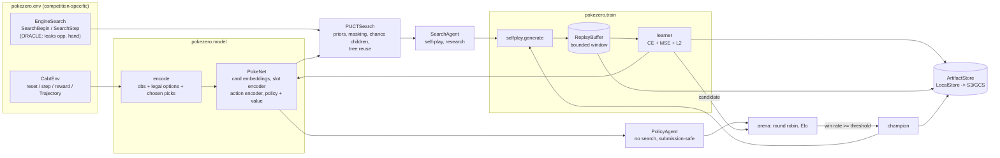

# PokeZero

An AlphaZero-style training system for the
[Pokémon TCG AI Battle Challenge](https://www.kaggle.com/competitions/the-pokemon-company-ptcg-ai-battle-challenge-playground),
adapted to a stochastic, imperfect-information game. This repository is a **CPU-runnable vertical
slice**: self-play → replay data → training → candidate-vs-champion evaluation → checkpoint, with
tests, typed config, optional W&B and a Docker image. It is built to be *correct and extensible*, not
strong: see [Status](#status-and-honest-limits).

> **Read this first: the engine's search leaks hidden information.** The only forward model the SDK
> exposes (`SearchBegin/SearchStep`) reproduces the opponent's real hand regardless of what the caller
> supplies ([evidence](docs/sdk-findings.md#cloning--search-the-key-question-for-mcts)). PUCT built on it
> is an *oracle*. It is therefore off by default (`search.allow_engine_oracle=false` raises), labelled
> research-only, and **never used by the submission agent**, which is a search-free policy network that
> sees only the real observation. The Playground rules I was given do not forbid search, and the official
> docs name the search API without documenting its arguments or hidden-information behaviour, so whether this
> leak is intended is unresolved.

## Setup

```bash
uv venv --python 3.12 && source .venv/bin/activate
uv pip install -e . pytest ruff mypy types-PyYAML     # torch comes from PyPI (CPU or CUDA wheel)
# smaller CPU-only torch:  uv pip install --index-strategy unsafe-best-match --extra-index-url https://download.pytorch.org/whl/cpu -e .
uv pip install -e '.[wandb]'                          # optional, only if you want W&B
```

The simulator is `kaggle-environments>=1.33.0` (`envs/cabt`); nothing needs Kaggle credentials to run
locally.

## Notebook

`notebooks/playground.ipynb` walks through a game, agent matches, the encoder and net, a short
config-driven training run with plots, and a replay. Locally: `uv sync --extra notebook` then
`jupyter lab`. On Colab, open it from GitHub; its first cell installs the package. It is committed
without outputs. Training can use a GPU (`train.device=auto`), but game simulation is CPU-only,
so self-play remains the bottleneck.

## Run

```bash
pokezero train --config configs/smoke.yaml            # ~15 s: one full cycle
pokezero train --config configs/default.yaml run_name=my_run iterations=10 selfplay.games_per_iter=16
pokezero eval  --games 40 --checkpoint runs/my_run/champion.pt   # round-robin win rate + Elo
pokezero bench --games 40 --sims 32                              # throughput numbers (below)
pokezero package --checkpoint runs/my_run/champion.pt --out submission.tar.gz
```

Any config value can be overridden as `a.b=value`. Runs are resumable (`champion.pt` is reloaded).
Artifacts for a run live under `runs/<run_name>/`:

| path | contents |
|---|---|
| `champion.pt`, `checkpoints/iter_NNNN.pt` | weights + net config (+ `promoted` flag) |
| `replay/iter_NNNN.npz` | self-play examples: observation encoding, legal-action mask, MCTS visit distribution, result `z` (no pickle) |
| `trajectories/iter_NNNN.jsonl` | every game's decks and picks |
| `metrics.jsonl`, `config.json` | per-iteration metrics, resolved config |

### Weights & Biases (optional, off by default)

```bash
uv pip install -e '.[wandb]' && export WANDB_API_KEY=...        # key stays in your environment
pokezero train --config configs/default.yaml wandb.enabled=true wandb.project=pokezero
# no network? wandb.mode=offline, then `wandb sync` later
```

With `wandb.enabled=true` you get: per-optimizer-step `train/loss|policy_loss|value_loss`; per-iteration
`iter/*` (candidate-vs-champion win rate, win rates vs random and heuristic, self-play sims/s, promotion);
every promoted champion uploaded as a model artifact (`wandb.log_checkpoints`); and a
candidate-vs-champion replay attached each iteration (`wandb.log_replays`). The default config writes only
`metrics.jsonl`; no key or entity is stored in the repo.

### Watching a game

```bash
pokezero replay --a heuristic --b random --out replay.html        # also: a checkpoint path
```

Opens in any browser with Kaggle's own replay viewer (step slider, both hands visible, spectator
view only). It runs through the official `kaggle_environments` runner; agents still see only their own
observation. The viewer is plain boxes and text, and there is no play-against-the-model mode yet.

### Docker

```bash
docker build -t pokezero .                      # CPU
docker build -t pokezero:cuda --build-arg BASE=nvidia/cuda:12.4.1-runtime-ubuntu22.04 \
             --build-arg TORCH_INDEX=https://download.pytorch.org/whl/cu124 .
docker run -v $PWD/runs:/app/runs pokezero train --config configs/smoke.yaml
```

The Dockerfile was written but **not built** in the environment this slice was developed in.

### Submission

`pokezero package` writes `submission.tar.gz` = `main.py` (exposes `agent(obs)`; returns the 60-card deck
when `obs["select"] is None`), the `pokezero` package and `model.pt`. It runs the policy network only,
validates every action, and falls back to the heuristic agent if torch is missing or anything raises.

The archive follows the Playground's documented layout (`main.py` at top level, `deck.csv`, under 197.7 MiB). It has never run on the real ladder, and PyTorch in the grader image is unconfirmed (the agent falls back to the heuristic). See [Playground rules and format](docs/sdk-findings.md#playground-rules-and-format-pasted-from-the-competition-page-on-2026-10-18).

## Architecture



Competition-specific code is confined to `pokezero/env/` (`cabt.py`, `engine.py`, `search_engine.py`,
`cards.py`). Everything else uses the `Decision` / `GameEnv` types in `env/base.py`.

**Action handling.** Each prompt is "pick between `min` and `max` distinct options". Multi-pick prompts
are decomposed into sequential single picks; the network scores every option plus a STOP row (legal once
`min` picks exist). The policy is a masked softmax over the current legal set, so the action space
varies per decision with no fixed global index.

**Model** (≈2.2M parameters, configurable): card-ID embeddings plus numeric card features from the
engine's card table; a shared encoder per Pokémon slot (9 per side: card, HP, attached energy by type,
tools, status); set-pooled own hand and both discard piles; global scalars (turn, prize/deck/hand
counts, status flags). The action encoder embeds option type/area/target, the referenced card and
attack. `logit_i = <W[h, ctx], a_i>/√d + b(a_i)`; value is `tanh(MLP(h))` ∈ [-1, 1].

## How this differs from canonical AlphaZero

| AlphaZero | PokeZero |
|---|---|
| Perfect information; the search state *is* the game state | The acting player sees only its own hand and public zones. The network input is exactly that. Search currently runs on an engine that leaks the opponent's hand (oracle), so tree statistics are conditioned on hidden info. At opponent nodes the network gets the public board only. |
| Deterministic transitions | Chance everywhere. Each edge keeps up to `max_chance_children` outcome children keyed by state hash; beyond that, outcomes are resampled in proportion to visits; edges that repeat one outcome stop calling the engine. |
| Fixed action space | Variable legal-option sets; multi-pick prompts decomposed into sequential picks with a STOP action. |
| Can copy a node by copying the board | Only via the engine's opaque search handles; no seeding anywhere (see findings). |
| Tree reuse is trivial | Reuse only inside one multi-pick prompt, or when a later own decision has an identical *public* state key found in the old tree. |
| Value = game outcome | Same (±1/0), zero-sum, stored per acting player. |
| Self-play data come from the current net | Same, but data are generated by the **champion** and a candidate is promoted only after beating it. |
| Large simulation budgets | 8-32 simulations on a laptop CPU; the slice proves the cycle, not convergence. |

## Measurable commands

Measured on a 4-core CPU container (no GPU), 2.2M-parameter net:

| metric | command | observed |
|---|---|---|
| Local games/s (random vs random) | `pokezero bench` | ≈ 112 games/s (≈ 6.5k decisions/s) |
| Policy-network games/s | `pokezero bench` | ≈ 30 games/s |
| Search throughput | `pokezero bench --sims 32` | ≈ 485 simulations/s, ≈ 665 engine calls/s |
| Heuristic vs random win rate | `pokezero bench` | 92.5% (40 games) |
| Round-robin Elo | `pokezero eval --games 40` | heuristic ≈ +240 over random |
| One training iteration (smoke) | `pokezero train --config configs/smoke.yaml` | ≈ 10 s |

Numbers vary with hardware; rerun the commands.

## Tests and quality gates

```bash
pytest -q          # 31 tests, ~10 s: adapter, legality/masking, no-hidden-info encoder, PUCT
                   # selection/backup/chance (scripted forward model), replay round-trip,
                   # config/storage/Elo, submission archive, one full training iteration + resume
ruff check . && ruff format --check . && mypy
```

CI (`.github/workflows/ci.yml`) runs the same on every PR.

## Status and honest limits

* The vertical slice works end to end, but **a policy trained for a few iterations is weak**. In a
  3-iteration demo (6 games × 16 simulations per iteration) the greedy policy collapsed to "End turn"
  and lost every game to random; nothing was promoted. That is the expected shape of from-scratch
  AlphaZero at this scale, not a result. The value head does fit its targets. Do not read the demo
  numbers as a measure of the approach.
* The initial hidden-information approximation is the oracle described above. Until a leak-free
  forward model exists, search-trained policies are trained against targets that used information the
  agent will not have at submission time.
* The engine cannot be seeded; reproducibility comes from recorded trajectories.
* One fixed starter deck is used for both players. No deck building.
* Docker image untested; CUDA path is infrastructure only (training is CPU).
* [`docs/sdk-findings.md`](docs/sdk-findings.md) lists confirmed behaviour and unresolved questions.

## Extension points (designed for, not built)

| later addition | where it plugs in |
|---|---|
| Ray self-play workers | `train.selfplay.generate` is a pure function of weights + config + seed; swap `LocalExecutor` |
| Batched GPU inference | `PokeNet.predict` takes a list of `Encoded`; put a batching server behind the same signature used by `PUCTSearch._expand` |
| Information-set MCTS / belief sampling | replace `EngineSearch` (the `engine=` argument of `PUCTSearch`) and `search_engine.begin`'s determinization |
| Historical-opponent league | `selfplay.generate` builds two agents; draw the second from stored `checkpoints/` |
| Public-replay imitation | produce `Example` rows (`agents/az.py`) from replays and add them to `ReplayBuffer` |
| S3/GCS storage | implement `storage.ArtifactStore` (`put_bytes/get_bytes/exists/list`) |
| W&B model registry | `tracking.Tracker` already owns the run; log checkpoints as artifacts there |
| ONNX Runtime / Triton | export `PokeNet.forward` over `collate` tensors; `PolicyAgent` only needs `predict` |

vLLM is intentionally not used: it serves language models, not this policy/value network.
